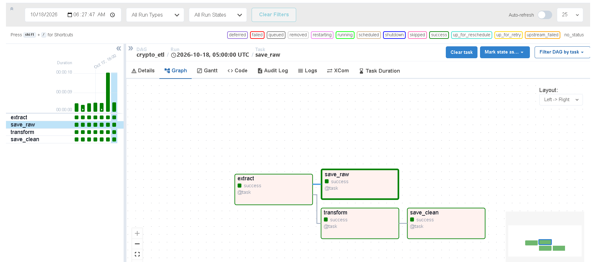
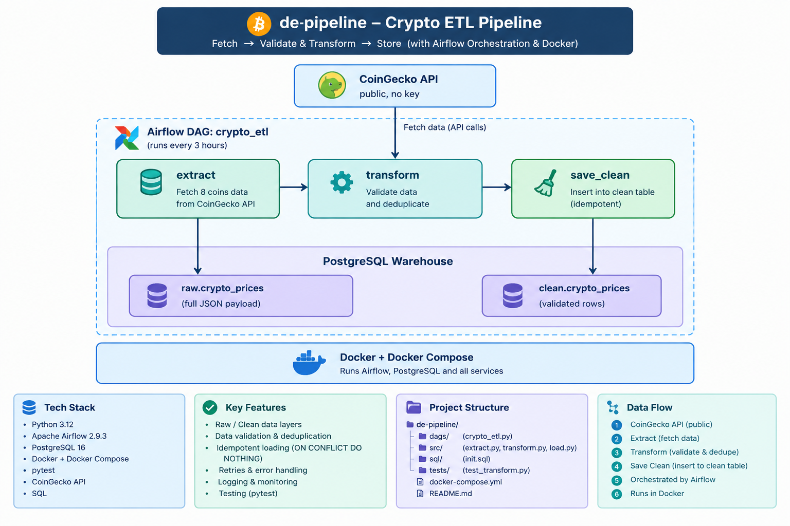
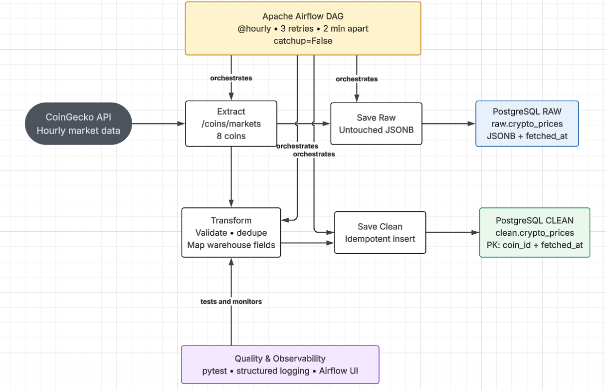

# 📈 Crypto ETL Pipeline

### ⚙️ Automated Data Ingestion, Validation, and Warehousing with Apache Airflow

🏢 **Project type:** Data Engineering (batch ETL and orchestration)
🐍 **Stack:** Python · Apache Airflow · PostgreSQL · Docker


---

## 🚀 1. Project Overview

The Crypto ETL Pipeline is a hands-on data engineering project that collects cryptocurrency market data from the public CoinGecko API every hour, validates and cleans it, and loads it into a PostgreSQL data warehouse. The workflow is scheduled and monitored with Apache Airflow, and the entire environment runs in Docker.

The warehouse is split into a **raw layer**, which keeps the untouched API response, and a **clean layer**, which holds validated, analysis-ready rows. Loads are idempotent, so retries and re-runs never create duplicate data.

This is an educational and portfolio project built and tested in a local Docker environment configured by the author, using a free public API. It is not a production system.



## 🎯 2. Objectives

- Ingest data from a public API on an hourly schedule.
- Orchestrate tasks with Apache Airflow, including dependencies and automatic retries.
- Clean and validate records in Python: reject invalid values and remove duplicates.
- Store raw and transformed data in a PostgreSQL warehouse.
- Package the whole stack with Docker so it runs the same on any machine.
- Add logging and automated tests for the transformation logic.
- Document the design, results, and limitations.

## 🏗️ 3. Architecture

Data flows from the API through an Airflow DAG with four tasks. The extracted data splits into two branches: one stores the raw response, the other validates it and loads the clean table.

**Overview**



**Detailed data flow**



```
CoinGecko API ──► extract ──┬──► save_raw ───────────────► raw.crypto_prices
                            └──► transform ──► save_clean ──► clean.crypto_prices
```

### 🧩 Main Components

- **CoinGecko API:** Public market data source, no API key required.
- **Apache Airflow:** Schedules the DAG hourly, manages task dependencies, and retries failures (3 times, 2 minutes apart).
- **Python modules:** `extract.py`, `transform.py`, and `load.py` hold the pipeline logic, separate from the DAG.
- **PostgreSQL (warehouse):** Stores the raw and clean schemas.
- **PostgreSQL (Airflow metadata):** A separate database used only by Airflow.
- **Docker Compose:** Starts the full stack with one command.
- **pytest:** Unit tests for the transformation rules.

### 🗄️ Warehouse Tables

| Table | Purpose |
|---|---|
| `raw.crypto_prices` | Full, unmodified API response stored as JSONB with a fetch timestamp |
| `clean.crypto_prices` | Validated rows: coin, price, market cap, 24h volume, 24h change, timestamp. Primary key: `(coin_id, fetched_at)` |

## 🛠️ 4. Tools and Technologies

- Python 3.12
- Apache Airflow 2.9.3 (TaskFlow API, LocalExecutor)
- PostgreSQL 16
- Docker and Docker Compose
- pytest
- CoinGecko public API
- SQL for querying the warehouse
- Visual Studio Code and Git

## 🔬 5. Scenarios and Methodology

### ▶️ Scenario 1: End-to-End Pipeline Run

The stack was started with Docker Compose and the `crypto_etl` DAG was triggered from the Airflow interface. All four tasks (`extract`, `save_raw`, `transform`, `save_clean`) completed successfully. The warehouse was then queried to confirm that rows for all eight coins had landed in the clean table.

### 🧪 Scenario 2: Validation and Automated Testing

The transformation logic was covered with five unit tests: valid records are kept and renamed, missing prices are dropped, zero or negative prices are dropped, missing ids are dropped, and duplicates are removed. All five tests passed.

### 🔄 Pipeline Workflow

1. Airflow triggers the DAG every hour.
2. `extract` calls the CoinGecko API for 8 coins.
3. `save_raw` stores the untouched response in `raw.crypto_prices`.
4. `transform` validates records, removes duplicates, and maps fields to warehouse columns.
5. `save_clean` inserts the validated rows into `clean.crypto_prices`, skipping any row that already exists.
6. Every stage writes logs that are visible in the Airflow interface.

## 📊 6. Key Findings and Results

- 🟢 **End-to-end run:** All four DAG tasks succeeded and data was loaded into both warehouse layers.
- 🔎 **Data check:** The DAG ran twice during testing (a manual trigger and a scheduled run), producing 16 rows in the clean table: 8 coins multiplied by 2 fetch timestamps. This confirmed that each run adds one row per coin and keeps runs separate.
- 🧪 **Tests:** 5 of 5 unit tests passed.
- 🛠️ **Debugging:** A syntax error in `load.py` caused an Airflow DAG import error. It was diagnosed from the traceback in the Airflow interface, fixed, and the scheduler was restarted so the corrected code loaded.

The findings are limited to the tests that were run. Automatic retries are configured in the DAG, but a forced task failure was not part of this version of the testing.

## 🔐 7. Recommendations and Future Improvements

- **Alerting:** Send email or Slack notifications when a task fails.
- **Data quality checks:** Add automated checks (for example with Great Expectations), including detection of implausible price jumps.
- **Secrets management:** Replace the hardcoded local credentials with environment files or a secrets manager.
- **Dashboard:** Build a visualisation layer on top of the clean table.
- **Scaling:** Move from LocalExecutor to CeleryExecutor or Kubernetes for larger workloads.
- **Next projects:** A streaming version with Kafka and a cloud warehouse version with dbt and BigQuery.

These are recommendations, not features claimed as implemented in this version of the project.

## ▶️ 8. How to Run

**Requirement:** Docker Desktop with the engine running.

```bash
git clone https://github.com/binnyhinn/de-pipeline.git
cd de-pipeline
docker compose up -d
```

1. Open http://localhost:8080 and log in with `admin` / `admin`.
2. Un-pause the `crypto_etl` DAG and trigger it.
3. Query the clean table:

```bash
docker compose exec warehouse-db psql -U warehouse -d warehouse -c "SELECT * FROM clean.crypto_prices LIMIT 8;"
```

4. Run the tests:

```bash
docker compose exec airflow-scheduler python -m pytest /opt/airflow/tests -v
```

To stop everything: `docker compose down` (add `-v` to delete the stored data).

### 📁 Project Structure

```
de-pipeline/
├── dags/          Airflow DAG
├── src/           extract, transform, load
├── sql/           warehouse schema
├── queries/       sample SQL queries
├── tests/         unit tests
├── docs/          report, diagrams, screenshots
└── docker-compose.yml
```

## 📚 9. Project Documentation

📄 **[View Full Project Report (PDF)](docs/Crypto_ETL_Pipeline_Report.pdf)**
The complete report covers the problem statement, objectives, architecture, database design, implementation, containerisation, testing, results, challenges and solutions, limitations, and future work.

## ⚠️ 10. Disclaimer

This project was developed for educational and portfolio purposes in a local Docker environment configured by the author. It uses a free public API and sample data only.

It demonstrates a practical batch data pipeline and is not a production system. Credentials in this repository are default local development values and must never be reused in a real environment. The CoinGecko free tier is rate limited, so changes to the schedule or the number of coins should respect those limits.

## 👨‍💻 11. Author Information

👤 **Author:** R. Binny Hinn
🎓 **Qualification:** Computer Science and Engineering (AI and ML), Ponjesly College of Engineering, Anna University (2026)
💼 **Focus:** Python development and data engineering

🔗 [GitHub](https://github.com/binnyhinn) · [LinkedIn](https://www.linkedin.com/in/binny-hinn-4303873ba)